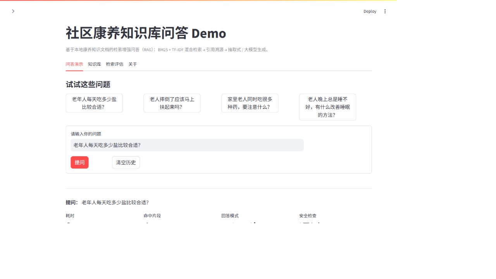
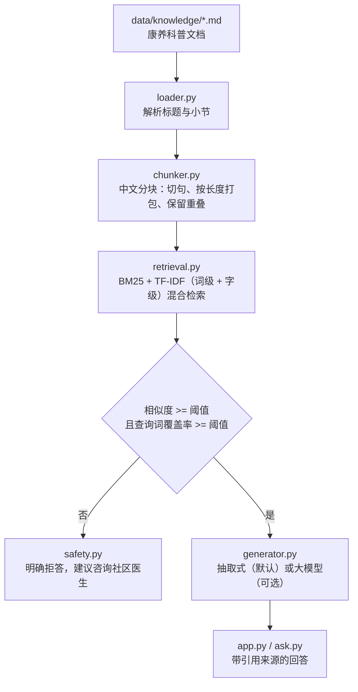

# 社区康养知识库问答 Demo（healthcare-rag-demo）

> 一个面向「社区康养 / 老年健康」场景的 **RAG（检索增强生成）** 学习项目：
> 本地知识文档 → 中文分块 → **BM25 + TF-IDF 混合检索** → 引用溯源 → 抽取式 / 大模型生成，
> 附带离线评估与医疗安全护栏。**不依赖任何付费服务即可离线跑通**。

测试状态：GitHub Actions 已通过（Python 3.10 / 3.11 / 3.12），见 [Actions 运行记录](https://github.com/2310629382-blip/healthcare-rag-demo/actions/workflows/ci.yml)。

---

## 界面预览



> 提问后会显示回答、检索耗时、引用来源（文档 · 小节 · 相似度）与检索明细分数。

## 项目亮点

| 特性 | 说明 |
| --- | --- |
| 完整 RAG 链路 | 加载 → 分块 → 检索 → 重排（阈值/覆盖率护栏）→ 生成 → 引用溯源，每个环节都能单独替换做对比实验 |
| 混合检索 | BM25（关键词稀疏检索）+ TF-IDF（jieba 词级 + 字符 2-3 gram），两路分数归一化后加权融合到 0~1 |
| 引用溯源 | 每条回答都给出「文档 · 小节 · 相似度 · 原文片段」，可直接点开核对 |
| 双重拒答护栏 | 相似度阈值 **+** 查询词覆盖率，知识库没有依据时明确说「不知道」，而不是让模型编 |
| 医疗安全护栏 | 识别胸痛、言语不清、跌倒后不能活动等急症信号 → 首句提醒拨打 120；涉及用药剂量 → 提示遵医嘱 |
| 大模型可选 | 支持任何 OpenAI 兼容接口（豆包 / DeepSeek / 通义 / 本地 Ollama）；不配置 API Key 时用内置抽取式回答，调用失败会自动回退 |
| 离线评估 | Hit@1 / Hit@K / MRR / 关键词覆盖率 / 拒答准确率，一条命令生成 Markdown 报告 |
| 工程化 | 单元测试（pytest）+ GitHub Actions CI（Python 3.10/3.11/3.12）+ 类型标注 + 结构化日志友好的返回对象 |

## 当前评估结果

评估集是自己构造的 19 条问题（16 条知识库内 + 3 条域外），见 `data/eval/questions.jsonl`：

| 指标 | 结果 | 含义 |
| --- | --- | --- |
| Hit@1 | **0.875** | Top-1 检索结果命中期望文档的比例 |
| Hit@3 | **0.938** | Top-3 检索结果命中期望文档的比例 |
| MRR | **0.896** | 第一个正确文档排名的倒数均值 |
| 关键词覆盖率 | **0.625** | 回答是否覆盖期望关键词（生成质量的粗粒度指标） |
| 拒答准确率 | **1.000** | 域外问题被正确拒答的比例 |
| 平均端到端耗时 | **3 ms** | 纯 CPU、本地检索 + 抽取式回答 |

> 注意：这是**小规模自建评估集**上的结果，只代表当前知识库与当前参数配置；换成别的知识库后需要重新校准阈值。

## 技术架构



数据流：data/knowledge -> loader.py -> chunker.py -> retrieval.py（BM25 + TF-IDF）
-> 安全与拒答护栏 -> generator.py -> app.py / ask.py

详细设计见 [`docs/architecture.md`](docs/architecture.md) 与 [`docs/design-notes.md`](docs/design-notes.md)。

## 快速开始

### 1. 环境要求

- Python 3.10 及以上（开发环境使用 3.12）
- 无需 GPU、无需联网也能运行（只有调用大模型时才需要网络）

### 2. 安装依赖

```bash
git clone https://github.com/2310629382-blip/healthcare-rag-demo.git
cd healthcare-rag-demo

# 方式一：conda
conda create -n healthcare-rag python=3.12 -y
conda activate healthcare-rag

# 方式二：venv
python -m venv .venv
.venv\Scripts\activate        # Windows
# source .venv/bin/activate   # macOS / Linux

pip install -r requirements.txt
```

### 3. 启动网页界面

```bash
streamlit run app.py
```

浏览器打开 <http://localhost:8501>，可以：

- 调整 **Top-K、拒答阈值、分块长度/重叠**，观察检索结果变化；
- 查看每条回答的**引用来源**与**检索明细**（BM25 / TF-IDF 各自得分）；
- 浏览知识库文档；
- 一键运行**离线评估**并下载 Markdown 报告。

Windows 用户也可以直接双击 `run_demo.bat`。

### 4. 命令行问答

```bash
python ask.py "老年人每天吃多少盐比较合适？"
python ask.py --show-retrieval "卫生间怎么改造能减少老人摔倒？"
python ask.py            # 不带问题则进入交互模式，输入 q 退出
```

### 5. 运行评估

```bash
python scripts/evaluate.py --verbose
python scripts/evaluate.py --output reports/eval_report.md
```

### 6. 运行测试

```bash
pip install -r requirements-dev.txt
pytest -q
```

## 配置说明

复制 `.env.example` 为 `.env` 后按需修改（`.env` 已在 `.gitignore` 中，不会泄露密钥）：

| 变量 | 默认值 | 说明 |
| --- | --- | --- |
| `TOP_K` | `4` | 最终送入生成阶段的检索片段数 |
| `MIN_SCORE` | `0.22` | 相似度阈值，低于该值判为「知识库没有依据」→ 拒答 |
| `MIN_COVERAGE` | `0.20` | 查询词覆盖率阈值，防止靠个别虚词蒙混过关 |
| `CHUNK_SIZE` / `CHUNK_OVERLAP` | `300` / `60` | 分块目标长度与相邻片段重叠字数 |
| `KNOWLEDGE_DIR` | `data/knowledge` | 知识库目录，放入新的 `.md` / `.txt` 即可扩充 |
| `USE_LLM` | `false` | 是否启用大模型生成 |
| `LLM_BASE_URL` | 火山方舟 | 任何 OpenAI 兼容接口的 base url |
| `LLM_API_KEY` | 空 | 大模型密钥，**不要提交到仓库** |
| `LLM_MODEL` | `doubao-seed-1-6-250615` | 模型名 / 推理接入点 ID |
| `LLM_TEMPERATURE` | `0.2` | 生成温度，医疗场景建议保持低温 |

切换成别的大模型只需要改 `LLM_BASE_URL` / `LLM_MODEL`，例如：

```dotenv
# DeepSeek
LLM_BASE_URL=https://api.deepseek.com/v1
LLM_MODEL=deepseek-chat

# 本地 Ollama
LLM_BASE_URL=http://localhost:11434/v1
LLM_API_KEY=ollama
LLM_MODEL=qwen2.5:7b
```

## 目录结构

```
healthcare-rag-demo/
├── app.py                      # Streamlit 网页界面
├── ask.py                      # 命令行问答入口
├── run_demo.bat                # Windows 一键启动
├── src/healthcare_rag/
│   ├── config.py               # 配置（环境变量 / .env）
│   ├── loader.py               # 知识文档加载与解析
│   ├── chunker.py              # 中文分块
│   ├── retrieval.py            # BM25 + TF-IDF 混合检索
│   ├── safety.py               # 急症识别、拒答话术、免责声明
│   ├── generator.py            # 抽取式 / 大模型生成
│   ├── pipeline.py             # 串联完整 RAG 流程
│   └── evaluation.py           # 离线评估指标与报告
├── data/
│   ├── knowledge/              # 知识库文档（Markdown）
│   └── eval/questions.jsonl    # 评估集
├── scripts/evaluate.py         # 评估命令行脚本
├── tests/                      # pytest 单元测试
├── docs/                       # 架构、设计决策、路线图
└── reports/                    # 评估报告输出目录
```

## 设计要点

1. **为什么用混合检索而不是直接上向量库？**
   小规模知识库上，BM25 对「高血压」「跌倒」这类关键词命中精准且完全可解释；中文没有天然空格，
   分词切错时字级 TF-IDF 还能兜底。两路融合比单路更稳，而且**零外部依赖、离线可跑**，
   便于把注意力放在 RAG 流程本身。向量检索在后续计划中作为对比实验加入。
2. **为什么要有「查询词覆盖率」这第二道拒答护栏？**
   在小语料里，BM25 的 IDF 会把「能」「一份」这类虚词的权重放大，导致域外问题也拿到不错的分数。
   实验发现：**只匹配上问题里 1/6 关键词**的片段，即使分数过线也不该拿来回答。
   加上覆盖率判断后，评估集上的拒答准确率从 0.000 提升到 1.000。
3. **为什么默认用抽取式回答？**
   抽取式回答完全由检索片段中的原句拼成，**可复现、零成本、不会幻觉**，适合作为基线；
   配置大模型后切换为生成式回答，并保留引用编号，两者可以用同一套评估集对比。
4. **为什么要有安全护栏？**
   医疗场景下「看起来很流畅的错误建议」代价很高。急症关键词直接引导拨打 120，
   用药剂量问题提示遵医嘱，知识库没有依据时明确拒答，并在所有回答后面附免责声明。
5. **评估为什么要带域外问题？**
   只测「能不能回答」是不够的，还要测「该不该回答」。评估集里刻意放了 3 条与康养无关的问题。

## 已知局限

- 知识库只有 9 篇科普文档，覆盖的疾病与场景有限；
- 纯关键词检索对**口语化表达**（例如把「食盐摄入」说成「吃盐」）召回不足，
  需要靠向量检索或同义词扩展改进，这是后续计划的第一项；
- 拒答阈值是在当前评估集上校准的，换知识库后需要重新调参；
- 知识库内容来自公开健康科普资料的整理，**仅用于技术演示**，不是医学建议。

## 后续计划

- [ ] 加入向量检索（`sentence-transformers` / BGE-small-zh）并与 BM25 做混合与对比实验
- [ ] 加入 Rerank（Cross-Encoder 或 bge-reranker）提升 Top-1
- [ ] 支持 PDF / Word 文档解析与增量索引
- [ ] 多轮对话（问题改写 + 指代消解）
- [ ] 用 Streamlit Community Cloud / Docker 部署演示站点
- [ ] 扩大评估集，补充人工标注与生成质量评估（忠实度、相关性）

详见 [`docs/roadmap.md`](docs/roadmap.md)。

## 免责声明

本项目仅用于技术学习与知识科普演示，知识库内容整理自公开健康科普资料，**不能替代医生面诊、诊断和处方**。
如有身体不适请及时就医；出现胸痛、意识不清、一侧肢体无力、大出血等急症信号，请立即拨打 120。

## License

[MIT](LICENSE)
