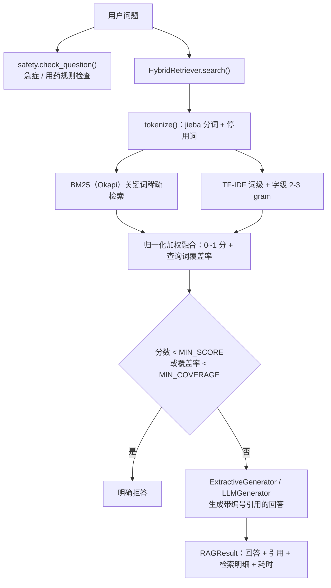

# 架构说明

## 1. 整体数据流



上图的文字版流程：

```
用户问题
  -> safety.check_question()      规则安全检查（急症 / 用药）
  -> HybridRetriever.search()     混合检索（BM25 + TF-IDF + 覆盖率）
  -> 拒答判断（阈值 / 覆盖率）      不通过则明确拒答
  -> 生成回答（抽取式 / 大模型）    带 [编号] 引用
  -> RAGResult                    回答 + 引用 + 检索明细 + 耗时
```

## 2. 模块职责

| 模块 | 职责 | 关键点 |
| --- | --- | --- |
| `config.py` | 集中管理配置 | 支持环境变量与 `.env`；默认值保证离线可跑 |
| `loader.py` | 读取 `data/knowledge/` 下的 `.md/.txt` | `#` 作为文档标题、`##` 作为小节，按文件名排序保证可复现 |
| `chunker.py` | 中文分块 | 标点切句 → 按目标长度打包 → 相邻片段保留重叠；保留文档/小节元信息 |
| `retrieval.py` | 混合检索 | 自实现 Okapi BM25；TF-IDF 用 sklearn 的 `TfidfVectorizer`（词级 + 字级） |
| `safety.py` | 医疗安全护栏 | 急症关键词、用药提醒、拒答话术、免责声明 |
| `generator.py` | 答案生成 | 抽取式（默认）/ 大模型（OpenAI 兼容）；异常自动回退 |
| `pipeline.py` | 串联全流程 | 对外只暴露 `HealthcareRAG.ask()`，返回结构化 `RAGResult` |
| `evaluation.py` | 离线评估 | Hit@1 / Hit@K / MRR / 关键词覆盖率 / 拒答准确率 |

## 3. 检索打分公式

**BM25（Okapi）**

```
score(D, Q) = Σ_{t∈Q} IDF(t) · f(t,D)·(k1+1) / ( f(t,D) + k1·(1 - b + b·|D|/avgdl) )
IDF(t) = ln( 1 + (N - df(t) + 0.5) / (df(t) + 0.5) )        k1 = 1.5, b = 0.75
```

**TF-IDF 余弦相似度**

```
tfidf_cos(D, Q) = cos( TFIDF(D), TFIDF(Q) )                  词级：sublinear_tf
char_cos(D, Q)  = cos( CharTFIDF(D), CharTFIDF(Q) )          字级：analyzer="char", ngram=(2,3)
```

**融合分数（最终用于排序和拒答判断）**

```
tfidf_score = (1 - char_weight) · tfidf_cos + char_weight · char_cos      char_weight = 0.3
bm25_norm   = BM25 / (BM25 + 4.0)                                        饱和归一化到 [0,1)
final_score = 0.5 · bm25_norm + 0.5 · tfidf_score
coverage    = 该片段命中的不重复查询词数 / 查询词总数
```

> 设计取舍：BM25 的原始分没有上界，直接与余弦相似度相加会被量纲支配，所以用
> `x/(x+c)` 做饱和归一化，把两路分数统一到 0~1 再加权，阈值才有可比性。

## 4. 分块策略

1. 先按 `。！？；` 和换行切句（过长的句子按 200 字硬切，避免单句超长）；
2. 顺序把句子加入缓冲区，超过 `CHUNK_SIZE`（默认 300 字）就输出一个片段；
3. 保留末尾若干句作为**重叠**（默认 60 字），避免答案被切在片段边界上；
4. 片段保留 `doc_id / doc_title / section` 元信息，引用时可以直接定位到「文档 · 小节」。

## 5. 拒答策略

| 情况 | 判断条件 | 行为 |
| --- | --- | --- |
| 知识库没有相关内容 | 最高融合分 < `MIN_SCORE` | 说明没有找到依据，建议咨询社区医生 |
| 只匹配到个别虚词 | 最高片段的 `coverage` < `MIN_COVERAGE` | 说明证据不足，明确拒答 |
| 空问题 | 输入为空 | 提示输入具体问题 |
| 急症描述 | 命中急症关键词 | **先**提示拨打 120，再给出知识库中的一般性科普 |
| 用药剂量问题 | 命中用药关键词 | 提示以医生处方和说明书为准 |

## 6. 评估方法

评估集 `data/eval/questions.jsonl` 每行一个 JSON：

```json
{"question": "老年人每天吃多少盐比较合适？", "expected_docs": ["高血压日常管理"], "keywords": ["5 克"]}
{"question": "帮我写一份 Java 求职简历", "expected_docs": [], "should_refuse": true}
```

| 指标 | 定义 |
| --- | --- |
| Hit@1 | Top-1 片段所属文档在 `expected_docs` 中的问题占比 |
| Hit@K | Top-K 片段中包含期望文档的问题占比 |
| MRR | 第一个正确文档排名的倒数均值（1/rank） |
| 关键词覆盖率 | 回答中包含期望关键词的问题占比 |
| 拒答准确率 | 域外问题被正确拒答的比例 |
| 平均耗时 | 端到端平均延迟（毫秒），检索 + 生成 |

## 7. 扩展点

- **换检索器**：`HybridRetriever` 只依赖 `Chunk` 列表，替换成向量检索只需实现同样的 `search()` 接口；
- **换生成器**：实现 `generate(question, retrieved) -> Answer` 即可，`pipeline.py` 无需改动；
- **换知识库**：把 Markdown 放进 `data/knowledge/`，或设置 `KNOWLEDGE_DIR`；
- **换评估集**：按 `questions.jsonl` 的格式新增问题即可。